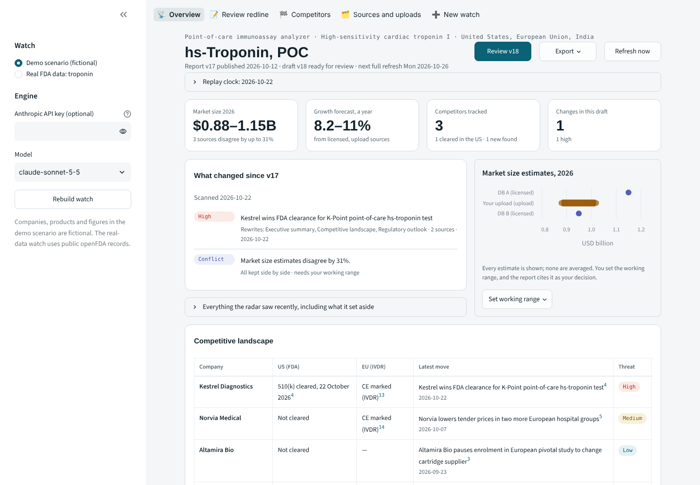
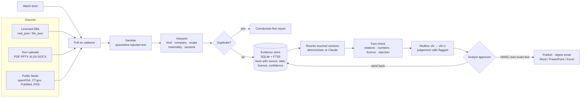
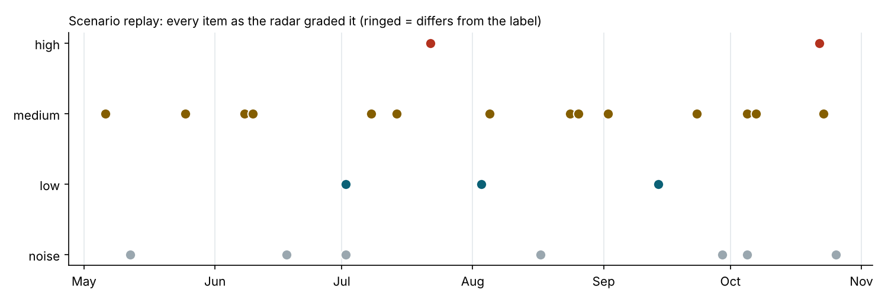
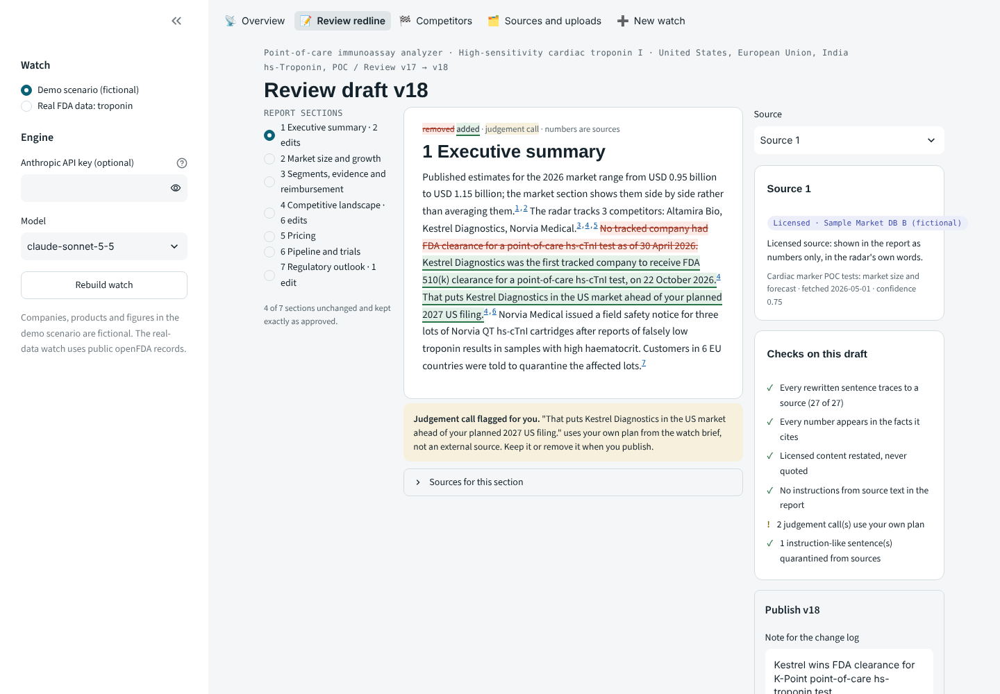
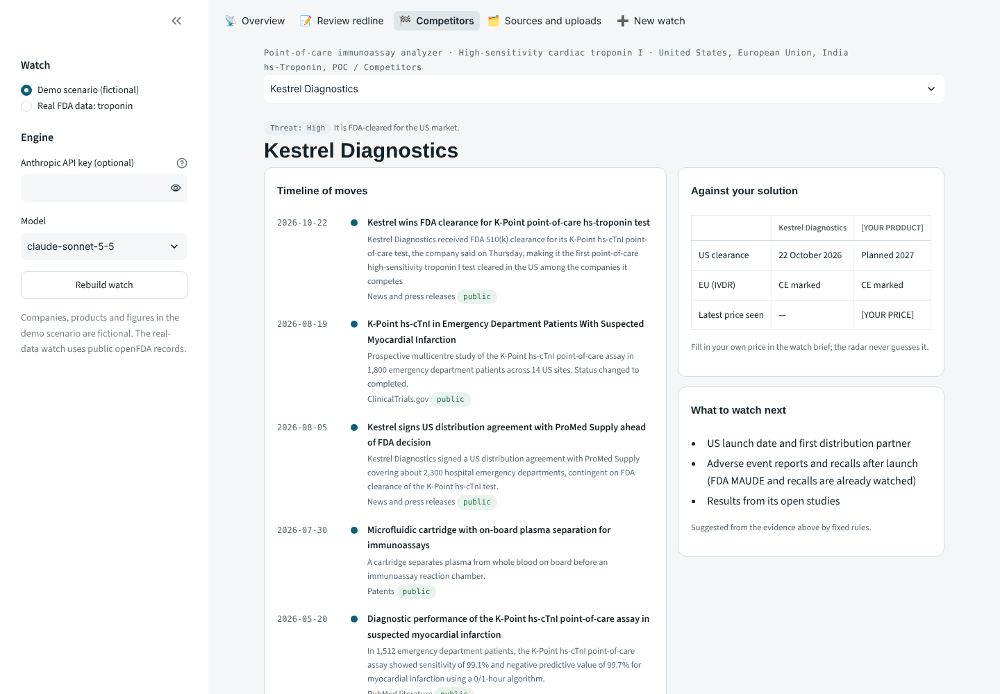
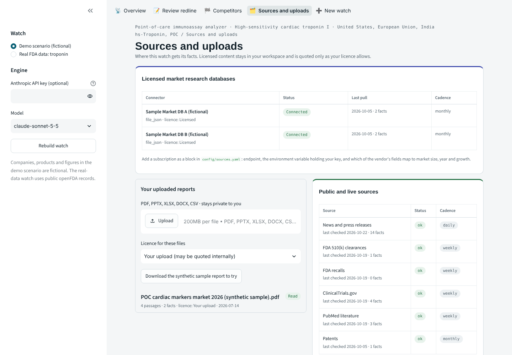

# MedTech Market Radar

[](https://github.com/muralimohan85/medtech-market-radar/actions/workflows/ci.yml)

**A market research and competitor analysis agent for medical devices.** You give it a watch brief (device type,
diagnostic solution, regions, competitors, your own product). It pulls from public sources, licensed market databases
and the reports you upload, then keeps a living research report up to date. It rewrites only the sections a new fact
affects, every sentence links to its source, and nothing is published until an analyst approves the redline.



The demo follows one watch: **point-of-care high-sensitivity troponin I** (rapid heart-attack rule-out in emergency
departments). It runs in two modes:

* **Demo scenario (fictional):** six months of invented news, FDA records, trials, licensed database rows and an
  uploaded report, replayed day by day. A safety notice on one competitor and a US clearance for another arrive along the way.
* **Real FDA data:** the same brief on every openFDA 510(k) decision and recall for troponin assays (product code MMI).
  Live API, or the committed snapshot when offline.

## What it does

| You asked for | How the radar does it |
|---|---|
| Connect to market research databases, configurable | Each vendor is a block in [`config/sources.yaml`](config/sources.yaml): endpoint, the env var that holds your key, and a field map. `rest_json` calls an API and `file_json` reads an export. Two fictional sample databases show the path end to end. |
| Upload reports | PDF, PowerPoint, Excel, Word, CSV or text. Each file is read locally, and market size, growth and price statements are extracted as facts tagged with your licence choice. Text that tries to instruct an AI is quarantined. |
| Inputs: diagnostic solution and device type | The watch brief ([example](config/watches/hs_troponin_poc.yaml)) also takes clinical use, regions, competitors, scope terms and your product. A *New watch* screen drafts it for you. |
| Subscribe to news for the topics | RSS/Atom feeds and company newsrooms are checked daily. openFDA 510(k) and recalls, ClinicalTrials.gov and PubMed are checked weekly. Licensed databases are checked monthly. Uploads are read straight away. Every source keeps its own cadence. |
| Keep refreshing the report and competitor analysis | Each new item becomes an event: what changed, which company, whether it is in scope, how material it is, and which sections it touches. A high-impact change opens a draft immediately; otherwise drafts open on the weekly refresh. Only the touched sections are rewritten, and the rest stay exactly as approved. |

## How it works



**Rules the code enforces (not just the prompt):**

1. **No source, no sentence.** Every sentence cites fact ids that exist and are dated on or before the edition. A sentence that compares a competitor with *your* plan is allowed, but it is marked as a judgement call for the analyst to keep or remove.
2. **Numbers must be in the cited facts.** The fact-checker rejects any figure it cannot find in the sources a sentence cites.
3. **Estimates are shown side by side, never averaged.** When sources disagree, the analyst sets a working range, and the report cites that range as the analyst's decision.
4. **Licences travel with facts.** Licensed wording is never quoted (no run of 8 words from a no-quote source). External exports withhold licensed and uploaded material, and you can keep a licence away from hosted models entirely.
5. **Source text is data.** Instruction-like sentences are removed before any engine reads them and kept on the source for review. A check also confirms none reached the report.
6. **Human approval for every edition.** The approval is an HMAC over the draft's content hash, so a draft edited after approval cannot be published.
7. **Materiality-gated alerts.** Duplicates corroborate the first report instead of alerting again, and out-of-scope items are logged with the reason they were set aside.

## Results

`python -m evaluation.run_eval` replays both watches day by day, with each source on its own cadence, and compares the
output with hand labels ([scenario](evaluation/scenario_labels.yaml), [real](evaluation/real_labels.yaml)).

<!-- EVAL:START -->
**Scenario replay** (29 fictional items, May to October 2026, deterministic engine)

| Check | Result |
|---|---|
| Right sections rewritten (exact match per change) | 100% (precision 100%, recall 100%) |
| Materiality graded as labelled | 100% |
| High-impact changes caught | 2/2 |
| Alert precision / recall | 100% / 100% |
| Noise kept out of alerts | 6/6 |
| Duplicates merged into the first report | 4/4 |
| Injected instruction quarantined | 1/1 (leaks into report: 0) |
| New competitor found | 1/1 |
| Sentences with a valid citation | 196/196 |
| Unsupported numbers / licensed wording copied | 0 / 0 |
| Untouched sections left exactly as approved | 99/99 |
| Sections rewritten per edition (of 7) | 1.5 |
| Days from publication to alert (median, max) | 0, 20 (news daily, FDA weekly, licensed monthly) |

**Real FDA data** (14 troponin 510(k) decisions and recalls, Jan 2023 to Oct 2026)

| Check | Result |
|---|---|
| Point-of-care vs central-lab, as labelled | 100% |
| Point-of-care events alerted | 4/4 |
| Central-lab events kept out | 10/10 |
| Sentences with a valid citation | 100% |
<!-- EVAL:END -->



**Read these numbers with care.**

* The scenario and its labels were written together, and the deterministic rules were tuned on that scenario. The
  scenario numbers show that the whole pipeline behaves as designed end to end; they are not a measure of how it does on
  unseen news.
* The real-data check is small (14 labelled events), and its scope terms were written for troponin. Its value is that the
  records are real.
* Headroom on unseen text is what the Claude engine is for. `make eval-claude` runs the same replay with Claude reading
  news and writing sections, and reports its cost.

## The screens

| Review the redline | Competitor profile | Sources and uploads |
|---|---|---|
|  |  |  |

* **Overview:** KPI tiles, what changed, the market-size estimates side by side (with your working range), and the competitor table with citations.
* **Review redline:** section-by-section del/ins, source cards with licence pills and corroboration, the checks on this draft, judgement-call flags, and *Approve and publish* or *Send back*.
* **Competitors:** timeline of moves (public, licensed and upload pills), comparison against your solution, and rule-based *what to watch next*. Companies the radar discovers are shown but tracked only after you accept them.
* **Sources and uploads:** connector status and fact counts, the upload dropzone with licence choice, cadence per feed, and quarantined text.
* **New watch:** a form that drafts the brief (search terms, FDA product code, out-of-scope terms) as YAML.

## Run it

```bash
pip install -r requirements.txt
make demo                       # Streamlit app; no API key needed
make test                       # 41 tests, offline
make eval                       # replay evaluation; updates the table above
make replay                     # the fictional scenario from the command line
make live                       # pull real public sources now and open a draft if anything changed
```

Docker: `docker build -t market-radar . && docker run -p 7860:7860 market-radar` (also works as a Hugging Face Space).

For continuous refresh, schedule `python -m radar run <watch>` (cron or a CI job). Drafts wait for
`python -m radar approve <watch> <n> --name "..."` or the review screen. Digests are written to `workspace/outbox/` as
`.eml` files; set `RADAR_SMTP_*` to send them. Set `RADAR_APPROVAL_SECRET` in any shared deployment.

## Two engines

| Step | Deterministic (default) | Claude (`--engine claude` or paste a key in the app) |
|---|---|---|
| Read structured records (FDA, trials, licensed rows) | Field mapping | Same |
| Read news and press releases | Keyword rules in [`config/rules.yaml`](config/rules.yaml) | Claude classifies kind, company and scope and restates the item. The restatement is rejected if it adds a figure not in the item. |
| Score, route, de-duplicate | Rules | Same rules, so the two engines differ only in reading |
| Write a section | Extractive templates from facts | Claude rewrites the section from cited facts (it can search the store). The fact-checker rejects the draft until it passes; if it never does, the deterministic writer takes over. |

Licensed facts reach the model as structured numbers only, never as the vendor's wording. The loop is about 120 lines
with no framework ([`radar/llm/claude.py`](radar/llm/claude.py)): a turn limit, a schema-validated terminal tool, prompt
caching and per-call cost in the trace. Tests drive it with a scripted fake client.

## Configure your own watch

1. Copy [`config/watches/hs_troponin_poc_live.yaml`](config/watches/hs_troponin_poc_live.yaml) and set the device, solution, regions, terms, FDA product codes, scope terms, competitors and your product. Or use the *New watch* screen.
2. Add your licensed databases to [`config/sources.yaml`](config/sources.yaml) and set their keys as environment variables. Pick a licence profile from [`config/licences.yaml`](config/licences.yaml).
3. Add RSS feeds for the outlets and company newsrooms you follow.
4. Run `python -m radar run <watch>`. The first run publishes a first edition from everything found; later runs open drafts.

## Notes and limits

* **Fictional demo.** Every company, product, outlet, study number and figure in the demo scenario is invented, and so are the two sample databases and the sample PDF. The real-data watch uses public openFDA records only.
* **Network.** openFDA works without a key. The ClinicalTrials.gov, PubMed and RSS connectors are written to each API's documented format and tested against recorded payloads, but they could not be reached from the environment this was built in. The *Sources* screen shows each connector's live status.
* **Not yet built.** There is no patent API (patents are replayed in the demo only), no EUDAMED connector (not yet public for this purpose), and CDSCO is covered only through news. Entity resolution uses aliases rather than a company graph.
* **Not advice.** This is a research tool. A human approves every edition.

## Layout

```
radar/
  connectors/   openFDA, ClinicalTrials.gov, PubMed, RSS, licensed (rest_json, file_json), scenario replay
  ingest/       interpret.py (scope, kind, materiality, routing, de-dup), uploads.py (PDF/PPTX/XLSX/DOCX)
  report/       writer.py (deterministic sections), checks.py (fact-checker), render.py (citations, redline),
                approval.py (HMAC gate), digest.py, export.py (docx/pptx/xlsx)
  agents/       classifier.py and writer.py (Claude engine)
  safety/       sanitizer.py (injection quarantine), licence.py
  engine.py     the radar: pull on cadence, ingest, draft, approve, replay
  store.py      SQLite evidence store with FTS5
config/         watches, sources, licences, rules
data/           real openFDA snapshot, fictional scenario, sample databases, sample upload
evaluation/     replay evaluation and labels
app/            Streamlit UI
docs/           design decisions
```

See [docs/design-decisions.md](docs/design-decisions.md) for the reasoning behind the main choices.

MIT licence · Murali Mohan
